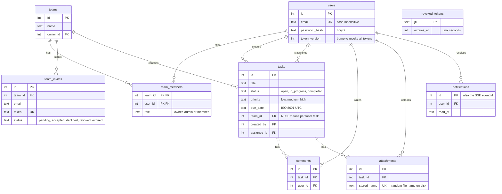

# Task Tracker API

A backend for a collaborative task tracking and management application, built with **Node.js, Express and SQLite**.
Users register, create tasks, organise themselves into teams, assign work to teammates, discuss tasks in comments,
attach files, and receive **real-time notifications**. An optional **generative-AI** feature drafts task descriptions and
summarises discussion threads.

- 100% of the brief's required features, plus both optional extensions (real-time notifications, AI assist)
- 93 automated tests covering every user story, authorisation rules and security edge cases
- Runs with **zero external services**: no database server to install, no API key required

> **Contents**
> [1. Features](#1-features-mapped-to-the-brief) ·
> [2. Quick start](#2-quick-start) ·
> [3. Configuration](#3-configuration) ·
> [4. Project structure](#4-project-structure) ·
> [5. How a request flows](#5-how-a-request-flows-through-the-app) ·
> [6. Data model](#6-data-model) ·
> [7. Authentication](#7-authentication-and-sessions) ·
> [8. Authorisation](#8-authorisation-who-can-do-what) ·
> [9. API reference](#9-api-reference) ·
> [10. Real-time notifications](#10-real-time-notifications-sse) ·
> [11. Generative AI](#11-generative-ai-assist) ·
> [12. Validation and errors](#12-validation-and-error-handling) ·
> [13. Security](#13-security-measures) ·
> [14. Testing](#14-testing) ·
> [15. Design decisions](#15-design-decisions-and-trade-offs) ·
> [16. Limitations](#16-known-limitations-and-next-steps) ·
> [17. Publishing to GitHub](#17-publishing-to-github) ·
> [18. Troubleshooting](#18-troubleshooting)

---

## 1. Features mapped to the brief

| # | User story | Where it lives |
|---|------------|----------------|
| 1 | Create an account | `POST /api/auth/register` |
| 2 | Log in securely | `POST /api/auth/login` (bcrypt-verified, returns a JWT) |
| 3 | View and update my profile | `GET` / `PATCH /api/users/me`, `PUT /api/users/me/password` |
| 4 | Create a task with title, description, due date | `POST /api/tasks` |
| 5 | List the tasks assigned to me | `GET /api/tasks?assignee=me` |
| 6 | Mark a task completed | `POST /api/tasks/:id/complete` (or `PATCH` with `status`) |
| 7 | Assign a task to a teammate | `PUT /api/tasks/:id/assignee` (or `assigneeId` on create/update) |
| 8 | Filter tasks by status | `GET /api/tasks?status=open,in_progress` |
| 9 | Search tasks by title or description | `GET /api/tasks?q=invoice` |
| 10 | Comment and attach files | `/api/tasks/:id/comments`, `/api/tasks/:id/attachments` |
| 11 | Create a team and invite members | `POST /api/teams`, `POST /api/teams/:id/invites`, `POST /api/invites/:token/accept` |
| 12 | Securely log out | `POST /api/auth/logout` (the token is revoked server-side) |
| 13 | *(optional)* Real-time notifications | Server-Sent Events at `GET /api/notifications/stream`, plus a persistent inbox |
| 14 | *(optional)* Generative AI | `POST /api/ai/task-description`, `POST /api/ai/tasks/:id/summary`, `generateDescription` on task create |

Beyond the brief: sorting and pagination, priorities and overdue detection, team roles (owner / admin / member),
invitation lifecycle (pending / accepted / declined / revoked / expired), password change that signs out other
devices, per-route rate limiting, graceful shutdown, and a health endpoint.

---

## 2. Quick start

**Requirements:** **Node.js 22 or newer** (the current LTS line; required by the `better-sqlite3` driver) and npm.
Check with `node -v`. If you use nvm, the included `.nvmrc` means `nvm use` picks the right version.

```bash
# 1. Install dependencies
npm install

# 2. Create your configuration file
cp .env.example .env
#    then open .env and set JWT_SECRET to a long random string. Generate one with:
#    node -e "console.log(require('crypto').randomBytes(48).toString('hex'))"

# 3. (Optional) load demo data: 3 users, 1 team, 6 tasks, comments
npm run seed

# 4. Start the server
npm start            # or: npm run dev   (auto-restarts when you edit a file)
```

The API is now at **http://localhost:3000**. Check it: `curl http://localhost:3000/health`.
The database file (`data/task-tracker.db`) and its tables are created automatically on first start.

**Demo accounts** (after `npm run seed`, password for all is `Password123`):
`alice@example.com` (owner of the "Website Relaunch" team), `bob@example.com`, `carol@example.com`.

### Try it in 60 seconds

```bash
# Log in and capture the token
TOKEN=$(curl -s -X POST http://localhost:3000/api/auth/login \
  -H 'Content-Type: application/json' \
  -d '{"email":"bob@example.com","password":"Password123"}' \
  | node -pe 'JSON.parse(require("fs").readFileSync(0)).data.token')

# Tasks assigned to me that are still open, soonest due date first
curl -s "http://localhost:3000/api/tasks?assignee=me&status=open,in_progress&sortBy=dueDate&order=asc" \
  -H "Authorization: Bearer $TOKEN"
```

A ready-made collection of every endpoint lives in [`docs/requests.http`](docs/requests.http). Open it in VS Code with the
free *REST Client* extension and click "Send Request" above any call.
(The `curl` examples work in Git Bash on Windows too. If `node -pe` quoting gives you trouble, copy the token by hand.)

### npm scripts

| Script | What it does |
|--------|--------------|
| `npm start` | Run the server |
| `npm run dev` | Run with automatic restart on file changes |
| `npm test` | Run the full test suite (in-memory database, offline) |
| `npm run migrate` | Apply pending database migrations and exit (the server also does this at start-up) |
| `npm run seed` | Insert demo data (does nothing if it is already there) |

---

## 3. Configuration

All settings are environment variables, read **only** in [`src/config/index.js`](src/config/index.js), validated once at
start-up, and exported as one object. Copy [`.env.example`](.env.example) to `.env`; every variable has a comment.

| Variable | Default | Purpose |
|----------|---------|---------|
| `NODE_ENV` | `development` | `production` enables strict checks (requires a real `JWT_SECRET`) |
| `PORT` | `3000` | HTTP port |
| `JWT_SECRET` | random per process (dev only) | Signing key. **Required, 32+ chars, in production.** |
| `JWT_EXPIRES_IN_SECONDS` | `3600` | Token lifetime |
| `BCRYPT_ROUNDS` | `12` | Password hashing cost |
| `DB_FILE` | `./data/task-tracker.db` | SQLite file (`:memory:` for throwaway) |
| `UPLOAD_DIR` / `MAX_UPLOAD_MB` | `./uploads` / `5` | Attachment storage and size limit |
| `INVITE_TTL_DAYS` | `7` | How long a team invitation stays valid |
| `CORS_ORIGINS` | `*` | Comma-separated allowed origins |
| `TRUST_PROXY` | `0` | Number of reverse proxies in front of the app |
| `AI_PROVIDER` | `auto` | `auto`, `anthropic` or `mock` (see [section 11](#11-generative-ai-assist)) |
| `ANTHROPIC_API_KEY`, `AI_MODEL`, `AI_TIMEOUT_MS` | unset, `claude-haiku-5-5`, `20000` | Only needed for real AI output |
| `RATE_LIMIT_*` | see `.env.example` | Request limits; `RATE_LIMIT_ENABLED=false` disables them |

If `JWT_SECRET` is missing in development the app generates a random one and warns you: it works, but every restart
logs everybody out. In production it refuses to start without one.

---

## 4. Project structure

```
task-tracker-api/
├── src/
│   ├── server.js              # process entry: migrate DB, open port, graceful shutdown
│   ├── app.js                 # builds the Express app (separate from server.js so tests can import it)
│   ├── routes.js              # mounts every feature router under /api
│   ├── config/index.js        # the ONLY place that reads process.env
│   ├── db/
│   │   ├── index.js           # SQLite connection + prepared-statement cache
│   │   ├── migrate.js         # tiny forward-only migration runner
│   │   └── migrations/001_init.sql   # the complete schema, heavily commented
│   ├── middleware/
│   │   ├── auth.js            # verifies the bearer token, sets req.user
│   │   ├── validate.js        # zod validation for params / query / body
│   │   ├── error-handler.js   # the single place errors become HTTP responses
│   │   ├── rate-limit.js      # general, auth and per-user AI limiters
│   │   └── upload.js          # multer: safe single-file uploads
│   ├── modules/               # one folder per feature: routes -> service -> database
│   │   ├── auth/              # register, login, logout, password hashing, JWT helpers
│   │   ├── users/             # profile and password change
│   │   ├── teams/             # teams, members, roles, invitations
│   │   ├── tasks/             # CRUD, filtering, sorting, searching, assignment
│   │   ├── comments/          # task discussion threads
│   │   ├── attachments/       # file upload / download / delete
│   │   ├── notifications/     # inbox, SSE hub, stream tickets
│   │   └── ai/                # description generation and summaries
│   └── utils/                 # HttpError, pagination, SQL helpers, shared zod schemas, file helpers
├── tests/                     # node:test + supertest, one file per feature area
├── scripts/                   # migrate.js, seed.js
├── docs/requests.http         # every endpoint, ready to click in VS Code
├── .env.example
└── uploads/                   # attachment bytes (git-ignored)
```

**Layering rule.** Each feature module has up to three files, and each layer has one job:

| File | Responsibility | Knows about |
|------|----------------|-------------|
| `*.routes.js` | HTTP only: URL, status code, which middleware runs | `req` / `res`, calls the service |
| `*.service.js` | Business rules, authorisation, SQL | the database, never `req` / `res` |
| `*.schemas.js` | Shape of valid input (zod) | nothing else |

Because services never touch `req`/`res`, they could be reused from a CLI, a job runner or a GraphQL layer unchanged.

---

## 5. How a request flows through the app

```
HTTP request
  │
  ├─ helmet ─ cors ─ morgan (logging) ─ express.json (100 kB body limit)
  │
  ├─ GET /health ───────────────────────────────────────────► {"status":"ok"}
  │
  └─ /api ─ generalLimiter ─ router
        │
        ├─ authenticate       verify JWT signature + expiry, load the user, check revocation   → 401
        ├─ validate(schema)   coerce and check params / query / body with zod                 → 422
        ├─ route handler      calls a service function
        │     └─ service      authorisation check, SQL, notifications                          → 403 / 404 / 409
        │
        └─ response  { "data": ... }  (lists add "meta": pagination)

 any thrown error ─► errorHandler ─► { "error": { "code", "message", "details?" } }
```

Express 5 forwards errors thrown from `async` handlers to the error handler automatically, so route handlers contain no
`try/catch` boilerplate: services simply `throw HttpError.notFound(...)`.

---

## 6. Data model

SQLite, accessed through `better-sqlite3`. The whole schema is in
[`src/db/migrations/001_init.sql`](src/db/migrations/001_init.sql) with comments on every table.



Key choices:

- **Personal vs team tasks.** `tasks.team_id` is `NULL` for a personal task (visible only to its creator) and set for a
  team task (visible to all members). One table, one set of endpoints, one visibility rule.
- **Timestamps** are ISO 8601 UTC text (`2026-10-20T07:25:32.441Z`). They sort correctly as plain strings, and
  due dates sent with any time zone offset are normalised to UTC on the way in.
- **Foreign keys are enforced** (`PRAGMA foreign_keys = ON`; SQLite leaves this off by default) with `ON DELETE CASCADE`
  where a child cannot exist without its parent. Deleting a team removes its tasks, comments, attachment rows and invites.
- **Indexes** cover the hot paths: tasks by team / assignee+status / creator / due date, comments by task, notifications
  by user + read state. A *partial unique index* guarantees at most one pending invitation per team and e-mail.
- **Attachments** store metadata in the database and bytes on disk under a random name (`stored_name`).
- **Migrations** are numbered `.sql` files applied once, in order, inside a transaction. The applied version is kept in
  SQLite's built-in `PRAGMA user_version`, so there is no bookkeeping table. To change the schema, add `002_xxx.sql`.

---

## 7. Authentication and sessions

**Registration** validates input, rejects a duplicate e-mail (case-insensitive, whitespace-trimmed), hashes the password
with **bcrypt** (cost 12), stores the hash, and returns a user object plus a JWT. The hash is never returned.

**Password policy:** at least 8 characters, at least one letter and one number, at most 72 bytes. The upper bound exists
because bcrypt silently ignores everything past 72 bytes; rejecting is safer than quietly truncating.

**Login** returns the same generic `Invalid email or password` for both "unknown e-mail" and "wrong password", and does
the same amount of hashing work in both cases (a dummy hash is compared when the account does not exist), so neither the
message nor the response time reveals which e-mails are registered.

**Tokens** are HS256-signed JWTs with an `iss` claim, `sub` (user id), `jti` (unique token id), `tv` (token version)
and `exp` (default 1 hour). Verification pins the algorithm, so `alg: none` and algorithm-confusion tokens are rejected
(there are tests for this).

**Real logout.** JWTs are stateless, which normally makes "log out" a client-side fiction. This API makes it real:

| Mechanism | Revokes | Triggered by |
|-----------|---------|--------------|
| `revoked_tokens` deny-list (by `jti`) | exactly one token | `POST /api/auth/logout` |
| `users.token_version` counter | every token the user ever got | `PUT /api/users/me/password` |

On each request the middleware verifies the signature and expiry, loads the user, compares `tv` with the stored version,
and checks the deny-list: two cheap indexed lookups. Deny-list rows are only needed until the token would have expired anyway
and are purged hourly.

Logging out on one device leaves your other sessions alone; changing your password signs out all of them and hands the
current client a fresh token.

---

## 8. Authorisation: who can do what

Authentication says *who you are*; authorisation says *what you may do*. Every rule is enforced in the service layer, so
no route can forget it.

**A deliberate rule: no information leaks.** If you cannot see a team or task, the API answers **404 Not Found**, never
403 Forbidden. An outsider therefore cannot even discover which ids exist. A 403 is only returned when you *can* see
the resource but lack the role for the action.

### Teams

| Action | Owner | Admin | Member | Non-member |
|--------|:----:|:----:|:----:|:----:|
| View team and members | ✅ | ✅ | ✅ | 404 |
| Edit name / description | ✅ | ✅ | 403 | 404 |
| Invite (as member) | ✅ | ✅ | 403 | 404 |
| Invite (as admin) | ✅ | 403 | 403 | 404 |
| Change a member's role | ✅ | 403 | 403 | 404 |
| Remove a member | any other | regular members only | 403 | 404 |
| Leave the team | ❌ must delete it | ✅ | ✅ | n/a |
| Delete the team | ✅ | 403 | 403 | 404 |

### Tasks, comments and attachments

| Resource | View / edit / assign / complete / comment / attach | Delete |
|----------|---------------------------------------------------|--------|
| **Personal task** | creator only | creator |
| **Team task** | every member of that team | creator, or team owner/admin |
| **Comment** | any member can write | edit: **author only** · delete: author, or team owner/admin (moderation) |
| **Attachment** | any member can upload and download | uploader, task creator, or team owner/admin |

Assignment rules: a team task can only be assigned to a *current member of that team*; a personal task can only be assigned to
yourself or nobody. A task cannot be moved between teams. When a member leaves or is removed, the team tasks assigned to them
become unassigned.

---

## 9. API reference

**Base URL:** `http://localhost:3000/api` · **Format:** JSON · **Auth:** `Authorization: Bearer <token>` on everything except
`register` and `login`.

**Response conventions**

```jsonc
// single resource
{ "data": { ... } }

// list
{ "data": [ ... ], "meta": { "page": 1, "limit": 20, "total": 57, "totalPages": 3 } }

// error (every error has this shape)
{ "error": { "code": "VALIDATION_ERROR", "message": "...", "details": [ { "path": "body.title", "message": "..." } ] } }
```

Status codes: `200` OK · `201` created (with a `Location` header) · `204` no content · `400` malformed JSON · `401` not
authenticated · `403` forbidden · `404` not found · `409` conflict · `413` too large · `415` unsupported file type · `422` validation
failed · `429` rate limited · `5xx` server / AI-provider problems.

### Authentication

| Method & path | Body | Result |
|---------------|------|--------|
| `POST /auth/register` | `{ name, email, password }` | `201` `{ user, token, tokenType, expiresIn }` |
| `POST /auth/login` | `{ email, password }` | `200` same shape |
| `POST /auth/logout` | none | `204`; this token is revoked immediately |

### Profile

| Method & path | Body | Result |
|---------------|------|--------|
| `GET /users/me` | none | your profile |
| `PATCH /users/me` | any of `{ name, jobTitle, bio }` (`null` clears jobTitle/bio) | updated profile |
| `PUT /users/me/password` | `{ currentPassword, newPassword }` | new session; every older token stops working |

### Teams, members and invitations

| Method & path | Notes |
|---------------|-------|
| `POST /teams` | `{ name, description? }`; creator becomes owner |
| `GET /teams` | teams I belong to |
| `GET /teams/:teamId` · `PATCH` · `DELETE` | see the permission table above |
| `GET /teams/:teamId/members` | owner first, then admins, then members |
| `PATCH /teams/:teamId/members/:userId` | `{ role: "admin" \| "member" }` (owner only) |
| `DELETE /teams/:teamId/members/:userId` | remove someone, or yourself to leave |
| `POST /teams/:teamId/invites` | `{ email, role? }` → returns the invitation **with its `token`** |
| `GET /teams/:teamId/invites` | pending invitations (owner/admin) |
| `DELETE /teams/:teamId/invites/:inviteId` | revoke |
| `GET /invites` | invitations addressed to *my* e-mail |
| `POST /invites/:token/accept` · `/decline` | answer an invitation (only the addressed account can) |

**How invitations work without an e-mail server.** The project has no mail service, so creating an invitation returns a
`token`. The inviter shares it (for example inside a link). If the address already belongs to a registered user, that user
also gets an in-app notification and sees the invitation under `GET /invites`. Invitations expire after 7 days, can only be
used by the e-mail they were issued to, and can only be answered once.

### Tasks

| Method & path | Notes |
|---------------|-------|
| `POST /tasks` | `{ title, description?, dueDate?, priority?, status?, teamId?, assigneeId?, generateDescription? }` |
| `GET /tasks` | filter / search / sort / paginate, see below |
| `GET /tasks/:taskId` | one task |
| `PATCH /tasks/:taskId` | any of `{ title, description, status, priority, dueDate, assigneeId }` |
| `DELETE /tasks/:taskId` | permission table above |
| `POST /tasks/:taskId/complete` | shortcut for `PATCH { status: "completed" }` |
| `PUT /tasks/:taskId/assignee` | `{ assigneeId: 12 }` to assign, `{ assigneeId: null }` to unassign |

**Task fields.** `title` ≤ 200 chars (required). `description` ≤ 5000. `status`: `open` · `in_progress` · `completed`.
`priority`: `low` · `medium` (default) · `high`. `dueDate`: `2026-11-01` (midnight UTC) or a full timestamp **with a time zone**,
such as `2026-11-01T17:30:00+05:30`; impossible dates like `2026-02-31` are rejected. The response also contains
`isOverdue` (past due and not completed), `completedAt` (set and cleared automatically as `status` changes), `commentCount`,
and `attachmentCount`.

**Listing, filtering, searching and sorting** (`GET /tasks`, every parameter optional, all combined with AND):

| Parameter | Example | Meaning |
|-----------|---------|---------|
| `status` | `open` or `open,in_progress` | one or several statuses |
| `priority` | `high` | one or several priorities |
| `assignee` | `me` · `none` · `12` | assigned to me / unassigned / a user id |
| `createdBy` | `me` · `12` | creator |
| `teamId` | `personal` · `3` | only personal tasks, or one team |
| `q` | `invoice` | case-insensitive search in title **and** description (`%` and `_` are matched literally) |
| `dueBefore`, `dueAfter` | `2026-12-31` | due-date range |
| `overdue` | `true` / `false` | only overdue / only not overdue |
| `sortBy` | `createdAt` (default) · `updatedAt` · `dueDate` · `priority` · `status` · `title` | sort field |
| `order` | `desc` (default) · `asc` | direction; tasks without a due date always sort last |
| `page`, `limit` | `1`, `20` | pagination (`limit` max 100) |

A user sees their own personal tasks plus every task in teams they belong to. For example:

```
GET /api/tasks?assignee=me&status=open,in_progress&sortBy=dueDate&order=asc     ← "my to-do list"
GET /api/tasks?q=invoice&teamId=3&priority=high                                 ← search within a team
GET /api/tasks?overdue=true                                                      ← what is late
```

### Comments

| Method & path | Notes |
|---------------|-------|
| `POST /tasks/:taskId/comments` | `{ body }` (≤ 2000 chars) |
| `GET /tasks/:taskId/comments` | oldest first, paginated |
| `PATCH /tasks/:taskId/comments/:commentId` | author only |
| `DELETE /tasks/:taskId/comments/:commentId` | author, or team owner/admin |

### Attachments

| Method & path | Notes |
|---------------|-------|
| `POST /tasks/:taskId/attachments` | `multipart/form-data`, one file in the field named **`file`** |
| `GET /tasks/:taskId/attachments` | metadata of every file (includes a `downloadUrl`) |
| `GET /tasks/:taskId/attachments/:attachmentId/download` | the file itself, sent as a download |
| `DELETE /tasks/:taskId/attachments/:attachmentId` | removes the row **and** the file on disk |

```bash
curl -X POST http://localhost:3000/api/tasks/3/attachments \
  -H "Authorization: Bearer $TOKEN" -F "file=@./design.pdf"
```

Allowed extensions: png, jpg, jpeg, gif, webp, pdf, txt, md, csv, json, doc(x), xls(x), ppt(x), zip. Maximum 5 MB
(configurable). See [section 13](#13-security-measures) for how uploads are made safe.

### Notifications

| Method & path | Notes |
|---------------|-------|
| `GET /notifications` | `?unread=true&page=&limit=`, newest first |
| `GET /notifications/unread-count` | `{ count }` |
| `PATCH /notifications/:id/read` · `POST /notifications/read-all` | mark as read |
| `GET /notifications/stream` | real-time Server-Sent Events, see [section 10](#10-real-time-notifications-sse) |
| `POST /notifications/stream-ticket` | one-time ticket for browser `EventSource` clients |

**Who gets notified of what**

| Event | Recipients |
|-------|-----------|
| Task assigned to you (at creation or later) | the new assignee |
| Task edited | task creator and current/previous assignee |
| Task completed | task creator and current/previous assignee |
| Task deleted | the assignee |
| Comment added / file attached | task creator and assignee |
| Team invitation | the invitee (if registered) |
| Invitation accepted | the inviter |

Nobody is ever notified about their *own* action.

### AI

| Method & path | Notes |
|---------------|-------|
| `POST /ai/task-description` | `{ title, context? }` → `{ description, provider, model }` |
| `POST /ai/tasks/:taskId/summary` | summary of a task and its comments → `{ summary, provider, model }` |

### Health

`GET /health` (no authentication) → `{ "status": "ok", "uptimeSeconds": 42 }`, for load balancers and uptime monitors.

---

## 10. Real-time notifications (SSE)

**Why Server-Sent Events rather than WebSockets?** Notifications only flow server → client. SSE is plain HTTP, passes through
proxies and load balancers without special setup, reconnects automatically, and has a built-in way to resume missed events.
WebSockets would add a protocol upgrade and a second connection lifecycle for no benefit here.

Every notification is (1) saved to the `notifications` table (so it is never lost if nobody is online) and (2) pushed
immediately to any open stream of that user, from [`src/modules/notifications/hub.js`](src/modules/notifications/hub.js).

### Connecting from a browser

The browser `EventSource` API cannot send an `Authorization` header, and putting a long-lived JWT in a URL is unsafe (URLs end up in
logs and history). So the API uses **one-time stream tickets**:

```js
// 1. Ask for a ticket using your normal token
const { data } = await fetch('/api/notifications/stream-ticket', {
  method: 'POST',
  headers: { Authorization: `Bearer ${token}` },
}).then((r) => r.json());

// 2. Open the stream with it. The ticket works once and expires after 30 seconds.
const events = new EventSource(`/api/notifications/stream?ticket=${data.ticket}`);

events.addEventListener('ready', (e) => console.log('connected, unread:', JSON.parse(e.data).unread));
events.addEventListener('notification', (e) => console.log('new:', JSON.parse(e.data)));
```

Non-browser clients and `fetch()` streaming can skip tickets and send the `Authorization` header on the stream request directly.

### What comes over the wire

```
retry: 5000

event: ready
data: {"unread":0}

id: 1
event: notification
data: {"id":1,"type":"task_assigned","message":"Alice Johnson assigned you the task \"Write launch announcement\"","data":{"taskId":3,"teamId":1,"actorId":1},"read":false,"readAt":null,"createdAt":"2026-10-20T07:25:32.441Z"}
```

(This is real output captured from a running server.) Every notification carries its database id as the SSE `id:`. If the
connection drops, the browser reconnects and sends `Last-Event-ID`; the server replays anything newer (up to 100) before
going live, so a flaky network cannot make you miss a notification. A `: keep-alive` comment is sent every 25 seconds so
idle connections are not cut by proxies.

---

## 11. Generative AI assist

Two features, both optional:

1. **Draft a description** from a title: `POST /api/ai/task-description`, or add `"generateDescription": true` when creating a task
   without a description. A description you write yourself is never overwritten.
2. **Summarise a task and its discussion**: `POST /api/ai/tasks/:taskId/summary` (status, decisions, open questions, next steps).

**Providers.** The code talks to one small interface with two implementations:

| `AI_PROVIDER` | Behaviour |
|---------------|-----------|
| `auto` (default) | Use Anthropic's Claude if `ANTHROPIC_API_KEY` is set, otherwise the offline template |
| `anthropic` | Always use Claude; returns `503 AI_NOT_CONFIGURED` if no key |
| `mock` | Deterministic offline template: no network, no cost, used by the test suite |

So the project demonstrates the feature end to end with **no API key**. To get real generated text, put your key in `.env`:

```
ANTHROPIC_API_KEY=sk-ant-...
AI_PROVIDER=auto
```

The Anthropic provider calls the Messages API with plain `fetch` (no SDK dependency), has a 20 s timeout, maps upstream failures to
`502` / `504` without leaking the provider's response, and never logs the key.

> ⚠️ **Honesty note:** the offline `mock` provider is covered by automated tests. The live Anthropic call was written against the
> documented Messages API but **was not exercised against the real service** while building this project (no API key was available).
> Try it with your own key and check the `provider` field in the response says `anthropic`. If your account uses a different model
> name, set `AI_MODEL`.

**Cost and abuse controls.** AI endpoints are rate-limited **per user** (10 / minute by default), summaries send at most the 50 most
recent comments (each truncated to 500 characters), and user text is passed to the model as JSON *data* with a system prompt that tells
it not to follow instructions found inside it. The model has no tools, and its output goes only to the user who asked.

---

## 12. Validation and error handling

**Validation** uses [zod](https://zod.dev). Each route declares schemas for `params`, `query` and `body`; the `validate` middleware parses
them, coerces types (`"42"` → `42` in URLs), trims strings, applies defaults, and reports **all** problems at once:

```json
{ "error": { "code": "VALIDATION_ERROR", "message": "Request validation failed",
  "details": [ { "path": "body.title", "message": "Title is required" },
               { "path": "body.dueDate", "message": "Not a valid calendar date" } ] } }
```

Unknown body fields are ignored, never saved. That is why `PATCH /users/me { "email": "x", "id": 9 }` cannot change an e-mail or an id.

**Errors** are thrown as `HttpError(status, code, message)` and converted in exactly one place
([`error-handler.js`](src/middleware/error-handler.js)). The stable `code` (for example `EMAIL_TAKEN`, `TASK_NOT_FOUND`,
`INSUFFICIENT_TEAM_ROLE`, `TOKEN_REVOKED`) lets clients react without parsing messages. Unexpected errors are logged server-side and
returned as a generic `500 INTERNAL_ERROR`: stack traces, SQL and file paths never reach the client. Malformed JSON, oversized bodies,
upload-limit violations and database constraint races each map to a proper 4xx.

---

## 13. Security measures

| Threat | Mitigation |
|--------|-----------|
| Stolen database | Passwords stored only as bcrypt hashes (cost 12, per-hash salt) |
| Password guessing | bcrypt cost; **20 register/login attempts per 15 min per IP** |
| Account enumeration | Identical login error and equalised timing; 404 instead of 403 for hidden resources |
| Token forgery | HS256 with a secret of 32+ characters (enforced in production); algorithm pinned; issuer checked |
| Stolen / lingering token | Short expiry, real logout (deny-list), password change revokes everything |
| SQL injection | Every value is a bound parameter; `ORDER BY` comes from a whitelist; `PATCH` columns come from a whitelist; `LIKE` wildcards escaped. There is a test that tries `' OR 1=1 --` and `sortBy=title;DROP TABLE tasks` |
| Broken access control | One central rule per resource, enforced in services, and tested for outsiders on every resource type |
| Malicious uploads | Extension allow-list (no `.html` / `.svg` / `.js`), size limit enforced while streaming, **random server-side file names** (no path traversal), downloads forced as attachments with `X-Content-Type-Options: nosniff`, access check **before** any byte is written, orphan files cleaned up on failure |
| XSS / clickjacking / sniffing | `helmet` security headers; the API only returns JSON or forced-download files |
| Abuse and DoS | Per-IP general limit, per-user AI limit, 100 kB JSON body limit, 5 MB upload limit |
| Information leaks | Generic 500s, no `X-Powered-By`, no stack traces, `password_hash` is never selected into API responses |
| SSE token exposure | Long-lived JWT never goes in a URL; one-time 30-second tickets instead |
| Misconfiguration | The app refuses to start in production without a strong `JWT_SECRET` |

Production checklist: set `NODE_ENV=production` and a strong `JWT_SECRET`; put the app behind HTTPS (a reverse proxy such as nginx
or Caddy) and set `TRUST_PROXY=1`; restrict `CORS_ORIGINS`; back up `data/` and `uploads/`.

---

## 14. Testing

```bash
npm test
```

93 tests in `tests/`, using Node's built-in test runner and [supertest](https://github.com/ladjs/supertest). Every file starts a fresh
**in-memory database** and temporary upload folder, uses the offline AI provider and needs no network, so the suite is fast (a few seconds)
and safe to run anywhere. Tests drive the real HTTP API, so they exercise routing, validation, authentication, services and SQL together.

| File | Covers |
|------|--------|
| `app.test.js` | health, JSON 404, malformed JSON, security headers, every protected route returns 401 |
| `auth.test.js` | registration, duplicate e-mails, password policy, login, forged / `alg:none` / expired tokens, logout, profile, password change |
| `teams.test.js` | team CRUD, role permissions, invitation lifecycle (accept / decline / revoke / wrong e-mail / duplicates), member removal rules |
| `tasks.test.js` | create / update / complete / delete, visibility, assignment rules, every filter, search wildcards, SQL-injection attempts, sorting, pagination |
| `collaboration.test.js` | comments (permissions, moderation) and attachments (byte-exact download, random names, type and size rejection, no writes for outsiders, disk cleanup) |
| `notifications.test.js` | inbox, read state, **live SSE streaming over a real socket**, ticket auth, `Last-Event-ID` replay, delivery isolation, unsubscribe on disconnect |
| `ai.test.js` | description generation, no overwrite of user text, summaries, access control |

Writing these tests found one real bug during development: JavaScript's `Date.parse` silently rolls impossible dates forward
(`2030-02-31` became March 3), so the API would have stored a due date the user never typed. The validator now checks the calendar
explicitly, with tests for it.

---

## 15. Design decisions and trade-offs

**SQLite instead of PostgreSQL or MongoDB.** The brief says "a chosen database system". SQLite means a reviewer can clone, `npm install`
and run, with nothing else to install, while still being a real relational database with transactions, foreign keys and indexes. It runs
in WAL mode for good read concurrency. The data is inherently relational (users ↔ teams ↔ tasks ↔ comments), which rules out a document
store. All SQL lives in the `*.service.js` files, so moving to PostgreSQL means rewriting those queries and the `db/` folder, not
restructuring the app. For a multi-server production deployment, PostgreSQL is the right next step.

**`better-sqlite3` is synchronous.** That is deliberate: queries are in-process and take microseconds, and a synchronous API is simpler, faster
than a callback driver for this workload, and makes multi-statement transactions trivial to get right.

**`bcryptjs` instead of native `bcrypt`.** A pure-JavaScript implementation installs everywhere (Windows, macOS, Linux, containers) without a C++
toolchain. It is somewhat slower per hash, which is acceptable at login-rate traffic.

**JWT plus a deny-list rather than server-side sessions.** Clients get the convenience of bearer tokens, and the server keeps the one capability
pure JWT lacks, instant revocation. The cost is one indexed lookup per request.

**One tasks table with nullable `team_id`.** Personal and team tasks share every endpoint, filter and rule. A separate "personal tasks" table would duplicate
all of that code.

**Notifications are persisted first, pushed second.** The inbox is the source of truth; SSE is a delivery optimisation. Missing a push never loses data.

**Services throw, the error handler responds.** Business code reads as a sequence of checks (`requireRole(...)`, `getAccessibleTask(...)`) with no
HTTP plumbing, and the error format cannot drift between endpoints.

---

## 16. Known limitations and next steps

Being upfront about what this version does **not** do:

- **Single server instance.** The SSE hub, stream tickets and rate-limit counters live in process memory. To run several instances, move them to Redis
  (pub/sub for the hub, a shared store for limits). The hub's `publish` method is the single place to change.
- **No e-mail delivery.** Invitations return a token instead of sending a message (see [section 9](#9-api-reference)). Plug a mailer into `createInvite`.
- **Local file storage.** Attachments live on the server's disk. For multiple servers, swap `middleware/upload.js` and `attachments.service.js` to S3-style object storage.
  There is no virus scanning.
- **No account deletion or e-mail change / verification / password-reset flows.** They were outside the brief.
- **Attachment content is not inspected.** Only the file extension is checked, so a renamed file would pass; this is mitigated by forced-download headers.
- **Live Anthropic calls are untested** (see the note in [section 11](#11-generative-ai-assist)).
- **Search is `LIKE`-based.** Fine for thousands of tasks per user; for large datasets, add SQLite FTS5 or PostgreSQL full-text search.
- **Not load-tested.**

Natural extensions: task labels, subtasks, @mentions in comments, activity history, recurring tasks, an OpenAPI/Swagger document, a React front end.

---

## 17. Publishing to GitHub

The brief requires a **public** repository. This project already contains a git history. From the project folder:

```bash
# Option A: GitHub CLI (creates the repo and pushes in one step)
gh auth login
gh repo create task-tracker-api --public --source=. --remote=origin --push

# Option B: create an empty PUBLIC repo named task-tracker-api on github.com first, then
git remote add origin https://github.com/<your-username>/task-tracker-api.git
git branch -M main
git push -u origin main
```

Before pushing, confirm that `.env` is **not** tracked (`git status` should not list it; `.gitignore` already excludes it) and that no real API key
is in any file. In the repository's *Settings → General → Danger Zone* confirm the visibility is **Public**.

---

## 18. Troubleshooting

| Symptom | Fix |
|---------|-----|
| `npm install` fails on `better-sqlite3` or reports an unsupported engine | Upgrade to Node 22 or newer (`node -v`). On a supported Node a prebuilt binary is downloaded; if none exists for your platform, install a C++ build toolchain (on Windows: *Visual Studio Build Tools*, "Desktop development with C++") |
| `JWT_SECRET is required in production` | Set a 32+ character `JWT_SECRET` in the environment |
| Everyone is logged out after each restart | You have no `JWT_SECRET` set in development (a random one is generated every run). Set it in `.env` |
| `EADDRINUSE` | Port 3000 is taken: set `PORT=3001` in `.env` |
| `429 RATE_LIMITED` while experimenting | Limits are per IP; raise `RATE_LIMIT_AUTH` or set `RATE_LIMIT_ENABLED=false` in development |
| `503 AI_NOT_CONFIGURED` | `AI_PROVIDER=anthropic` but no `ANTHROPIC_API_KEY`; use `auto` or `mock` |
| SSE stream seems to "hang" behind nginx | Disable proxy buffering for that route (`proxy_buffering off;`); the API already sends `X-Accel-Buffering: no` |
| Reset all data | Stop the server and delete the `data/` folder (and `uploads/`) |

---

## License

MIT
